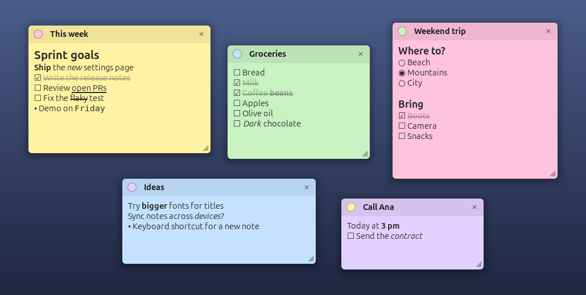
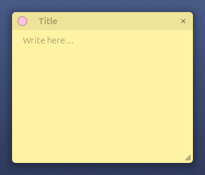
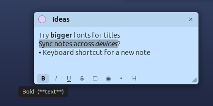

<p align="center">
  
</p>

<h1 align="center">SimpleDeskNote</h1>

<p align="center">
  <b>Sticky notes that live on your GNOME desktop.</b><br>
  Live formatting, clickable checklists and positions that follow your monitors.
</p>

<p align="center">
  
  
  
</p>

<p align="center">
  
</p>

---

## Why SimpleDeskNote?

- 🗒️ **Right on the desktop.** Notes sit above the wallpaper and desktop icons,
  below your windows, so they are there when you need them and out of the way
  when you don't. Prefer them always visible? Switch on **Above windows**.
- ✍️ **Formatting as you type.** Write `**bold**` or `[ ] task` and it renders
  immediately; the markup characters stay hidden.
- ☑️ **Checklists you can click.** Tick ☐ items, pick one ◉ option out of a
  group, and keep lists going with <kbd>Enter</kbd>.
- 🖥️ **Multi-monitor aware.** Unplug the external monitor and your notes move
  to a screen you still have; plug it back and they return to where they were.
- 💾 **Nothing to save.** Every change is stored automatically.

## See it in action

<table>
  <tr>
    <td align="center" width="50%">
      
      <br><sub><b>Live markup</b>: headings, checklists, bold, italic and strikethrough render while you type</sub>
    </td>
    <td align="center" width="50%">
      
      <br><sub><b>Formatting toolbar</b>: every button has a hint showing its shortcut</sub>
    </td>
  </tr>
</table>

## Features

| | |
|---|---|
| **Desktop layer** | Below windows, above the wallpaper and desktop icons, or above everything |
| **Title** | Next to the color dot; drag it to move the note, click it to edit |
| **Live markup** | Bold, italic, underline, strikethrough, code and two heading sizes |
| **Checkboxes & radios** | Click ☐ or ○ to toggle; radios allow one choice per group |
| **Smart lists** | <kbd>Enter</kbd> continues ☐ ○ • lists, <kbd>Enter</kbd> on an empty item ends them |
| **Toolbar** | B · I · U · S · ☐ · ◉ · • · H, visible while editing, with hints |
| **Five colors** | Yellow, pink, green, blue and purple |
| **Resize & scroll** | Resize from the corner; long notes scroll inside |
| **Per-monitor positions** | Each note remembers its place on every monitor |
| **Top bar menu** | New note, show/hide all, above windows, and a list of your notes |

## Markup cheat sheet

Type the shortcut, or use the toolbar at the bottom of the note.

| You type | You get |
|---|---|
| `[ ] task` / `[x] done` | ☐ checkbox / ☑ checked and struck through |
| `( ) option` / `(x) chosen` | ○ radio / ◉ selected |
| `- item` | • bullet |
| `# Heading` / `## Subheading` | larger bold line |
| `**bold**` · `*italic*` · `__underline__` · `~~strike~~` · `` `code` `` | inline styles |

- Click a ☐ or ○ symbol to toggle it.
- <kbd>Shift</kbd>+<kbd>Enter</kbd> adds a plain line break inside a list.
- Select styled text and click **B**, **I**, **U** or **S** again to remove the style.

## Installation

Requires **GNOME Shell 51**.

### From a release

1. Download `simpledesknote@lucas.local.shell-extension.zip` from the
   Releases page.
2. Install it:

   ```bash
   gnome-extensions install --force simpledesknote@lucas.local.shell-extension.zip
   ```

3. Log out and back in (required on Wayland), then enable it:

   ```bash
   gnome-extensions enable simpledesknote@lucas.local
   ```

### From source

```bash
git clone <this repository>
cd SimpleDeskNote
make install
```

Log out and back in, then enable it as above. `make pack` builds the zip into
`dist/` without installing it.

## Usage

Click the pencil in the top bar:

- **New note** creates a note in the middle of the primary monitor.
- **Show notes** hides or shows all notes at once.
- **Above windows** keeps notes on top of every window.
- The list below opens a note and puts the cursor in it.

On a note:

- Drag the header, or the title while it is not being edited, to move it.
- Click the colored dot to change the color.
- Click ✕ to delete; a note with text asks you to confirm.
- Drag ◢ to resize. A note never gets narrower than its toolbar.

## Multiple monitors

Each note remembers its position on every monitor it has been on, plus the
monitor where you last placed it, its *home*.

- **Home monitor unplugged**: the note moves to the most recent position it had
  on a monitor that is still connected, or to the primary monitor.
- **Home monitor back**: the note returns to its saved position there.

Monitors are recognized by vendor, model and serial number, so moving a cable
to another port doesn't matter. Screens that report no serial number, such as
most laptop panels, are recognized by their connector.

## Your data

Notes are stored in `~/.local/share/simpledesknote/notes.json`. Back it up to
keep your notes, or copy it to another machine.

## Contributing

Bug reports and ideas are welcome; see [CONTRIBUTING.md](CONTRIBUTING.md) and
the [changelog](CHANGELOG.md).

## License

SimpleDeskNote is free software, licensed under the
[GNU General Public License v3.0 or later](LICENSE).

The pencil icon comes from the [Yaru icon theme](https://github.com/ubuntu/yaru)
(`document-edit-symbolic`) by Sam Hewitt and the Ubuntu Yaru team, licensed
[CC BY-SA 4.0](https://creativecommons.org/licenses/by-sa/4.0/). The logo in
`docs/icon.svg` places that pencil on a sticky note and is also licensed
CC BY-SA 4.0.
